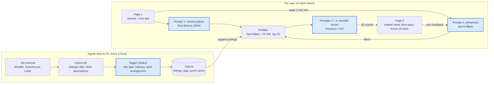

# InternMatch Architecture

InternMatch reads a STEM student's resume and search preferences, then ranks open internships by how competitive the student would actually be, with a recruiter-style explanation for each one. Regular code pulls, filters and sorts listings. The LLM handles the parts that need judgment: reading the resume, tagging postings, scoring fit, and turning plain-English requests into filters.

The full prompt text for every LLM call is in [PROMPTS.md](PROMPTS.md).

## Scope

- **STEM students only:** engineering, technology, science and math. A non-STEM resume still parses, but page 2 shows: "InternMatch is built for STEM students, so results may be thin for your field." The user can continue.
- **Runs locally for now.** The code is written so it can be deployed later without changes: API keys in `.env`, the API base URL and CORS origins read from config, nothing hardcoded to localhost.
- **No accounts.**

## System overview

Two pipelines share one SQLite database. The ingest pipeline runs on a schedule, pulls internship postings, and tags each new one with a role type and work arrangement. The per-user pipeline parses the resume, filters, and scores. Only the top 20 postings ever reach the recruiter scorer.



Blue boxes are LLM calls: the tagger at ingest, then the four graded prompts per user. Everything else is plain code, which keeps costs low and results predictable.

## Pages and user inputs

Users give two kinds of input:

- **Profile:** who they are. Skills, projects, experience, school, grad date and city. It comes from the resume and is editable on page 2.
- **Search preferences:** what they want. The resume can't tell us these, so the user sets them. Both are editable on page 2, and the chat on page 3 changes the preferences.

| Page | What's on it | LLM work |
| --- | --- | --- |
| 1. Upload | Resume upload (PDF or Word), plus a "What are you looking for?" box, for example "find me aerospace positions near LA" | None |
| 2. Review | Parsed profile on top (with parse warnings as yellow notes), search preferences below, pre-filled from the page 1 text | Prompt 1 (parse), Prompt 4 initial mode (free text to starting filters) |
| 3. Results | Ranked cards with "Why this score", refinement chat with filter chips, "Score 10 more" button, unscored "Also open" list | Prompts 2 + 3 (score), Prompt 4 refine mode |

The first visit goes through all 3 pages. After that, the profile is saved in the browser, so a returning user lands on page 3. A "Clear my data" button wipes the saved profile.

### Search preferences

| Preference | Input | Default | Filter state field |
| --- | --- | --- | --- |
| Industries | Multi-select from the 13 industry lists | All (empty list) | `industries` |
| Role types | Multi-select, grouped into Engineering, Technology, and Science & Math | Pre-checked from the resume's `suggested_role_types` | `role_types` |
| Home city | Text (city and state), checked against the cities file | From the resume | `home_city` |
| Max distance | Miles, any positive number | Blank, meaning no limit | `max_distance_miles` |
| Work arrangement | Multi-select: in-person, hybrid, remote | All three | `work_arrangements` |
| Term | Multi-select: Summer 2027, Fall 2026, Spring 2027 | Summer 2027 | `terms` |
| Posted within | Any, 7 days, 30 days | Any | `posted_within_days` |
| Exclude companies | List of names | Empty | `exclude_companies` |

`include_keywords`, `exclude_keywords`, `emphasis` and `sort_by` are also in the filter state, but only the chat sets them. The full filter state schema is in [PROMPTS.md](PROMPTS.md#prompt-4-refinement-iterative-refinement).

### Result cards

Each scored card shows:

- `fit_score`, `tier`, `top_matches` and `recruiter_note`
- the posted or updated time
- the work arrangement

"Why this score" expands into the requirements table, with green, yellow and red dots for met, partial and not met. A `needs_check` eligibility gate (unclear grad timing or degree field) shows as a gray tag, not a penalty.

- **Arrangement:** a card whose arrangement isn't stated shows "Arrangement not listed."
- **Term:** a card whose term couldn't be read shows "Term not listed."
- **Dates:** a card says "Posted X ago" when there's a real posted date, or "Updated X ago" when only `updated_at` exists. With neither, it says "Date unknown" and sorts last.

## Taxonomy

These codes are the single source of truth. They are shared by the taggers, the parser, the refinement prompt, the filter UI and the database. Keep them in one module (for example, `backend/app/taxonomy.py`) and build prompt lists from it.

### Industries (13, plus `other`)

| Code | Label |
| --- | --- |
| `aerospace_defense` | Aerospace & Defense |
| `space` | Space |
| `automotive_mobility` | Automotive & Mobility |
| `software_internet` | Software & Internet |
| `semiconductors_hardware` | Semiconductors & Hardware |
| `biotech_pharma` | Biotech & Pharma |
| `medical_devices` | Medical Devices |
| `energy_climate` | Energy & Climate |
| `robotics_automation` | Robotics & Automation |
| `manufacturing_industrial` | Manufacturing & Industrial |
| `civil_infrastructure` | Civil & Infrastructure |
| `research_labs` | Research & National Labs |
| `quant_fintech` | Quant & Fintech |

The company tagger can also return `other`. Companies tagged `other` still show up when the industry filter is set to All. `other` is not a selectable filter option.

### Role types (22, in 3 groups)

| Group | Codes |
| --- | --- |
| Engineering | `mechanical`, `electrical`, `aerospace`, `civil_structural`, `chemical`, `biomedical`, `industrial_manufacturing`, `materials`, `environmental`, `controls_gnc`, `embedded_firmware`, `test_integration` |
| Technology | `software`, `data_ml`, `cybersecurity`, `it_infrastructure`, `computer_hardware` |
| Science & Math | `biology_lab`, `chemistry_lab`, `physics`, `earth_environmental_science`, `math_statistics` |

The posting tagger can also return `non_stem`. Those postings are dropped at ingest.

**Industry and role type are separate tags.** Industry comes from the company: seed-list companies take their list's industry, and Simplify companies are tagged once by the company tagger. Role type comes from the posting itself, through the posting tagger. "Software intern at a rocket company" is role type `software` in industry `space`. Both are separate filters, and leaving either blank means "all."

### Work arrangement values

`in_person`, `hybrid`, `remote`, `not_stated`. "Not stated" postings are included by default.

## Data sources

| Source | What we use | Posted date | Work arrangement |
| --- | --- | --- | --- |
| [SimplifyJobs Summer 2027 repo](https://github.com/SimplifyJobs/Summer2027-Internships) | Title, company, locations, terms, degree levels (`degrees`), apply link from `.github/scripts/listings.json` on the `dev` branch. No descriptions. | `date_posted` (Unix timestamp) | As in [Ingest step 5](#ingest-and-tagging): Lever's `workplaceType` for a Lever apply link, else the posting tagger if a Greenhouse or Lever description was pulled, falling back to the location text ("Remote", "Hybrid"); anything else is `not_stated` |
| [Greenhouse Job Board API](https://developers.greenhouse.io/job-board.html) | Full descriptions for each seed-list company: `https://boards-api.greenhouse.io/v1/boards/{board}/jobs?content=true` | `first_published`, falling back to `updated_at` (shown as "Updated") | No built-in field, so the posting tagger reads the description |
| [Lever Postings API](https://github.com/lever/postings-api) | Full descriptions for each seed-list company: `https://api.lever.co/v0/postings/{board}?mode=json` | `createdAt` | Built-in `workplaceType`: remote, onsite, hybrid or unspecified. Code uses it whenever it isn't unspecified. |

- **Internships only:** Simplify lists only internships. Greenhouse and Lever boards list every job, so a board posting is kept only if its title matches `intern`, `internship`, `co-op`, `coop` or `apprentice` (case-insensitive). Most internships are full-time, so "full-time" is never a reason to drop a posting.
- **Terms:** Simplify gives terms directly. Board postings have no term field, so code reads it from the title, then the description, with a regex for a season plus a year ("Summer 2027", "Fall 2026"). If nothing matches, `terms` is stored as `["unknown"]`.
- **Descriptions for Simplify postings:** a Simplify posting whose apply link is a Greenhouse or Lever URL gets its description pulled from that API.
- **Title-only postings:** every other title-only posting goes to the unscored "Also open" list.
- **Not used:** LinkedIn or Indeed. They block scraping, and it would break during a live demo.

### Seed lists

The Greenhouse and Lever companies live in `backend/data/companies.yaml`. They're grouped into the 13 industry lists, with about 6 to 8 companies each (around 90 total). Adding a company is one line. **The starting companies still need to be researched,** and each company's board name confirmed.

```yaml
space:
  - name: Example Launch Co
    ats: greenhouse        # or lever
    board: examplelaunch   # the slug from the company's job board URL
aerospace_defense:
  - ...
```

When a user picks industries, the app uses those industry lists, plus any Simplify companies tagged with the same industry.

## Ingest and tagging

The ingest job runs inside FastAPI using APScheduler, Monday to Friday every 6 hours, in the `INGEST_TIMEZONE` time zone (default `America/Los_Angeles`). It also runs on startup if the last run was more than 6 hours ago. A 6-hour schedule only fires while the app is running, which is why the startup check matters. The startup run is a background job: the app serves the data it already has right away, and new postings appear when the run finishes. Only one ingest runs at a time.

1. Pull Simplify, then every seed-list board. Record whether each pull succeeded.
2. Keep only internships on board postings (see [Data sources](#data-sources)), and read their terms. Keep postings the source still lists as open (for Simplify, `active` is true) for the supported terms (Summer 2027, Fall 2026, Spring 2027) plus `unknown`. Drop postings whose every location is outside the US ("London, UK"); unknown location text such as "Multiple Locations" is kept. Record each posting's degree levels (`undergrad`, `masters`, `phd`) from Simplify's `degrees` list (Bachelor's and Associate's mean undergrad, Master's and MBA mean masters).
3. Drop duplicates. First match on the Greenhouse or Lever job ID, taken from the board data or from a Simplify apply link. Without an ID, match on company, title and location. A merged posting takes Simplify's degree levels; a posting still without them gets them from title keywords ("BS/MS", "UG", "PhD", "Master's", "Undergrad"), and nothing found means unknown. A later run that finds no levels keeps the ones already stored.
4. Pull descriptions for Simplify postings with a Greenhouse or Lever apply link.
5. Run the **posting tagger** once on each *new* posting.
   - Postings with a description get role type and work arrangement.
   - Title-only postings are tagged from the title alone, for role type only.
   - Postings tagged `non_stem` are dropped. Code remembers the dropped posting IDs, so they are never tagged again.
   - Work arrangement, in order: Lever's own `workplaceType` when it isn't "unspecified" (for any posting whose data came from the Lever API, including a Simplify posting with a Lever apply link); else the tagger's answer; else, when that is `not_stated` or the posting is title-only, the location text ("Remote" in the location means remote, and "Hybrid" means hybrid).
6. Run the **company tagger** once for any new Simplify company that isn't on a seed list. Seed-list companies take their list's industry.
7. Save everything to SQLite. A posting is never tagged twice, and a company is never tagged twice.
8. Update which postings are open. A feed is one pull: `simplify`, or one board keyed `{ats}:{board}` (for example `greenhouse:acme`). Each posting's `sources` column holds every feed that has ever listed it. Code adds to it at dedupe and never removes from it.
   - If any feed listed the posting as open this run, set `active = true` and `last_seen`. This also reopens a posting that came back. A Simplify row marked inactive doesn't count as open.
   - Otherwise, set `active = false` only if every feed in its `sources` was pulled successfully this run. A board feed that is no longer in `companies.yaml` (the company was removed, or its `ats` or `board` changed) counts as pulled successfully, with nothing listed.
   - Otherwise a feed failed, so leave the posting as it is. One network error never hides a posting.
   - Search only reads active postings.

Both taggers use `claude-haiku-5-5` at effort `low`. Their prompts are in [PROMPTS.md](PROMPTS.md#ingest-taggers).

## Location and distance

Distance is city to city. The user's home city and each posting's locations are looked up in a free offline US cities file with latitude and longitude (`backend/data/us_cities.csv`, built from the public-domain US Census Gazetteer places file by `backend/scripts/build_cities.py`). One location string can name several cities ("Atlanta, GA; Irvine, CA"); each one counts. Distance is computed with the haversine formula, with no API calls.

- **Aliases:** a small alias table maps common short names (LA, SF, NYC, Bay Area, DC and similar) to a city in the file. It is used for both home cities and posting locations.
- **Home city check:** `home_city` is looked up whenever it changes. If it can't be found, page 2 shows "City not found". In the chat, code drops the change. If no change was applied after validation, code replaces the reply with a fixed sentence; otherwise it adds the sentence to the reply: `I couldn't find {city}, so your home city didn't change. Try 'City, ST'.` While the home city is empty or can't be found (for example, a resume with no city, or a city missing from the file), the distance check is skipped and the "City not found" note stays visible. An unknown home city never silently hides results.
- **No limit:** if max distance is blank, there's no distance check.
- **Remote postings** skip the distance check.
- **Hybrid, in-person and not-stated postings** pass if *any* of their locations is within range.
- **Unplaceable locations:** when a limit is set, postings whose location can't be found (typos, "Multiple Locations," non-US cities) are hidden. A note says how many, for example "8 postings hidden because their location couldn't be found."
- **Remote only:** if Remote is the only arrangement selected, the miles box is grayed out.

## Prefilter and scoring

1. **Hard filters (code):** industry, role type, term, degree level, posted within, work arrangement, distance, excluded companies, and the chat-only include and exclude keywords.
   - **Degree level:** comes from the profile's class standing, not a filter field: freshman to senior see undergrad roles, `masters` sees Master's roles, `phd` sees PhD roles. Postings with unknown levels are kept, and an `unknown` standing sees every level. The student changes it by editing class standing on page 2.
   - **Term:** postings with an `unknown` term are kept, the same way `not_stated` arrangements are kept.
   - **Posted within:** uses the posted date, or the updated date when that's all there is. "Date unknown" postings are hidden while this filter is set.
2. **Split:**
   - Postings **with** descriptions are ranked by TF-IDF similarity (`scikit-learn`) between the profile text and the posting text. The top 20 go to the scorer.
   - Postings **without** descriptions that pass the filters go to "Also open," newest first. They are never sent to the scorer.
3. **Scoring:** Prompts 2 + 3 run once per posting, in parallel, using `asyncio.gather` with a semaphore of about 20, so the first page takes about one call's time. Anything already in the score cache is skipped.
4. **Score 10 more:** sends the next 10 postings from the prefilter ranking to the scorer, and appends the results.
5. **Sorting:** results sort by `fit_score` by default. The chat can switch `sort_by` to `posted`.

## Refinement loop

Prompt 4 never edits results directly. It returns a small list of changes to the filter state, and code applies them.

1. Validate every change against the refine field table, and drop anything invalid (see [PROMPTS.md](PROMPTS.md#what-code-does-with-the-output)).
2. Apply the changes. On page 2 they pre-fill the form. On page 3 each one shows as a chip above the results ("Within 30 mi", "Weighing: controls work"), and the user can undo it.
3. Rerun the prefilter. A posting already scored is never rescored, since it comes from the cache. Postings that newly enter the top 20 are scored, so their cards show a loading state.
4. If `emphasis` changed, every top 20 posting is rescored, since the scoring itself changed.
5. Show the `reply` in the chat.

The last 3 rounds of messages and replies are sent with each refine call, so "actually, put Seattle back" works.

## Privacy and caching

- **Profile storage:** no accounts. The parsed profile lives in the browser's local storage and is sent with each request. It's never written to the server's disk.
- **Resume handling:** the resume file is read in memory and thrown away after parsing. The parser keeps only city and state, never a street address or ZIP.
- **What SQLite stores:** listings, tags, and the score cache.
- **Cache key:** `(profile hash, job id, emphasis, prompt version)`. The profile hash is built from everything *except* location, and the profile is sent to the scorer without its location field. Changing your city or radius never rescores a posting already scored. The prompt version is a short hash of the scorer prompt files, the taxonomy labels and the model name, so editing the prompt never serves old scores.
- **Clear my data** wipes the browser copy of the profile.

## Tech stack

| Layer | Pick | Why |
| --- | --- | --- |
| Frontend | React + Vite + Tailwind in TypeScript, React Router for the 3 pages | Clean, fast to style |
| Backend | Python + FastAPI | Easy PDF parsing and data work, async for parallel LLM calls |
| Scheduler | APScheduler inside FastAPI | Runs ingest Mon to Fri every 6 hours, no separate service |
| Resume text | `pdfplumber` (PDF), `python-docx` (Word) | Plain text goes to Prompt 1, and the file is never saved |
| Prefilter | Hard filters in code, then TF-IDF similarity (`scikit-learn`) | No extra API cost; picks the top 20 to score |
| Distance | Offline US cities CSV + haversine | Free, fast, works offline |
| LLM | Claude API: `claude-sonnet-5-5` for Prompts 1 and 4, `claude-haiku-5-5` for scoring and tagging | Scoring and tagging are high volume, so the fast model fits |
| Validation | Pydantic models for every LLM output | One retry with the validation error on failure |
| Storage | SQLite | Listings, tags and the score cache |

No call sets `temperature`. Current Claude models fix their sampling: the SDK has no `temperature` argument, and Haiku 5.5 and Sonnet 5.5 reject non-default sampling. The taggers and the scorer run at effort `low`; the parser and refinement use the model's default effort.

## Data model (starting proposal)

These tables cover everything above. Adjust freely during the build.

| Table | Key columns |
| --- | --- |
| `postings` | `id`, `source` (simplify, greenhouse, lever), `sources` (JSON: every feed that has ever listed it, only added to), `company`, `title`, `locations` (JSON), `terms` (JSON), `url`, `ats_job_id`, `posted_at`, `date_kind` (posted, updated, unknown), `description`, `has_description`, `lever_workplace` (so a posting whose tag call failed can be retagged from its stored data), `degree_levels` (JSON: any of undergrad, masters, phd; `[]` means unknown), `role_type`, `work_arrangement`, `active`, `first_seen`, `last_seen` |
| `companies` | `name`, `industry`, `industry_source` (seed_list or tagger), `confidence`, `ats`, `board` |
| `scores` | `profile_hash`, `job_id`, `emphasis`, `prompt_version`, `result_json`, `created_at` |
| `ingest_runs` | `started_at`, `finished_at`, counts per source, error notes |

## API (starting proposal)

| Endpoint | Input | Output |
| --- | --- | --- |
| `POST /api/parse` | Resume file (multipart, PDF or DOCX, up to 5 MB, refused with 413 before upload when larger) + optional free text | `profile`, starting `filters`, Prompt 4 `reply`, `is_stem`, `home_city_found`. Runs Prompt 1, builds the default filters from `suggested_role_types` and city, then runs Prompt 4 in initial mode. Prompt 4 is skipped when the free text is empty, and `reply` is then empty. |
| `POST /api/search` | `profile`, `filters`, `offset` | Scored cards, the 50 newest "Also open" postings plus `also_open_total`, hidden-location count, `has_more`, `home_city_found`, and the postings it couldn't score |
| `POST /api/refine` | `filters`, `message`, results summary, recent turns | `intent`, applied `changes`, `dropped` changes, `reply`, updated `filters` |
| `GET /api/city?q=` | A city as "City, ST" | `found`: whether the cities file has it, for page 2's "City not found" |
| `GET /api/meta` | None | Taxonomy lists and labels, supported terms, last ingest time |
| `POST /api/ingest` | None | Triggers an ingest run. Exists only when `ENABLE_ADMIN_ROUTES=true` (default false). |

"Score 10 more" calls `/api/search` with the next `offset`.

## Request flow

1. **Page 1:** the user uploads a resume and optionally types what they're looking for.
2. Prompt 1 parses the resume. If `is_stem` is false, the app shows the STEM-only message. Code builds the default filter state from the parsed `suggested_role_types` and city. Only then does Prompt 4 (initial mode) turn the free text into starting preferences, so it starts from the resume's role types instead of a blank state. With no free text, Prompt 4 is skipped.
3. **Page 2:** the user checks and edits the profile and preferences.
4. **Prefilter:**
   - Code applies every hard filter.
   - Postings with descriptions are ranked by TF-IDF, and the top 20 move on.
   - Title-only postings that pass go to "Also open."
5. Prompts 2 + 3 score the 20 in parallel, skipping anything already cached.
6. **Page 3:**
   - Cards are sorted by fit score.
   - The chat sends feedback through Prompt 4 (refine mode). It changes the filters, and the list updates.
   - "Score 10 more" scores the next 10.

## Demo reliability

The live demo runs for real, used the way a normal user would. If an LLM call fails during a search, the app automatically falls back to cached results where they exist, and shows what it couldn't score instead of failing the page.

The fallback only helps if the cache already holds the demo's scores, since the key includes the profile hash. Before the demo:

1. With `ENABLE_ADMIN_ROUTES=true`, run `POST /api/ingest`, so the data is fresh and no startup ingest runs on stage. Do this within 6 hours of the demo, and check that no scheduled run (every 6 hours) falls between the warm-up in step 2 and the end of the demo. A new run can push unscored postings into the top 20.
2. Run the exact demo resume and chat steps once, to fill the cache.
3. After that, don't edit the profile or the scorer prompts. Either change gives a new cache key and empties the fallback.