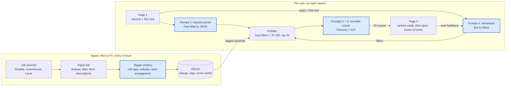

# InternMatch

InternMatch matches STEM students to open internships they could actually get. A student uploads a resume and says what they're looking for. The app ranks open internships by how competitive the student would be, explains each score the way a recruiter would, and lets the student refine the results in plain English.

Built for CS4680 Prompt Engineering. It covers engineering, technology, science and math students. A non-STEM resume still works, with a note that results may be thin.

## How it works

1. **Upload:** a PDF or DOCX resume, plus an optional "What are you looking for?" box.
2. **Review:** the parsed profile and search preferences, all editable.
3. **Results:** postings open to the student's degree level (from the class standing on page 2), then the top 20 scored matches, each with a fit score, a tier (strong, good, stretch or long shot), a recruiter note and a "Why this score" table. A chat refines the search, "Score 10 more" scores the next 10, and "Also open" lists postings that have only a title.

There are no accounts. The profile lives in the browser's local storage and is sent with each request. The server never stores a resume or a profile, and "Clear my data" wipes the browser copy.

## Architecture

Two pipelines share one SQLite database. Ingest runs on a schedule and tags new postings. The per-user pipeline parses the resume, filters, and scores. Only the top 20 postings after the prefilter ever reach the scorer.



Blue boxes are LLM calls. Everything else is plain code: filters, distance, TF-IDF ranking, caching.

- **Backend:** Python, FastAPI, SQLite, APScheduler, scikit-learn, the Anthropic SDK.
- **Frontend:** React, TypeScript, Vite, Tailwind, React Router.
- **Models:** `claude-sonnet-5-5` for the parser and refinement, `claude-haiku-5-5` for the scorer and the ingest taggers.

The full design is in [ARCHITECTURE.md](ARCHITECTURE.md), and the exact text of every prompt is in [PROMPTS.md](PROMPTS.md).

## The four prompt patterns

- **Few-Shot + structured output, [Prompt 1: resume parser](PROMPTS.md#prompt-1-resume-parser-few-shot--structured-output).** Three worked examples (a CS, a mechanical engineering and a biology student) are sent as user and assistant turns before the real resume. The output is one JSON profile with six skill buckets, validated by Pydantic, with one retry that includes the validation error. The parser keeps only city and state from the address.
- **Persona, [Prompts 2 + 3: recruiter scorer](PROMPTS.md#prompts-2--3-recruiter-scorer-persona--chain-of-thought).** The scorer is a senior technical recruiter who has screened thousands of intern applications for the posting's field, for example "embedded firmware roles at space companies", and is known for honest scores. The field is built from the posting's role type and industry tags, so the reviewer changes with the job.
- **Chain-of-thought, same prompt.** The scorer works in fixed steps before it scores: list each requirement as must, nice or inferred, then mark each as met, partial or not met with evidence from the profile, then apply the rubric. The JSON puts the reasoning fields before `fit_score`, so the score is written last. The UI shows this reasoning as the "Why this score" table.
- **Iterative refinement, [Prompt 4: refinement](PROMPTS.md#prompt-4-refinement-iterative-refinement).** The student's plain-English message ("closer to home, and weigh my controls work more") becomes a set of filter changes. Code validates each change, applies it, and searches again. Each change shows as a chip the student can undo. Only an `emphasis` change rescores; location and distance changes only re-filter.

Two supporting Haiku calls tag each new posting and company at ingest.

## Evaluation

The evaluation compares the app's scorer (persona + chain-of-thought) with a bare prompt: "Rate how well this candidate fits this internship from 0 to 100. Reply with only the number." Both get the same profile and posting text and run with the app's Haiku settings.

- **Student:** a made-up mechanical engineering junior ([eval/profile.json](eval/profile.json)).
- **Postings:** 10 real postings from a spread of prefilter ranks and role types, frozen in [eval/postings.json](eval/postings.json).
- **Labels:** written by Claude from the rubric in [eval/label_sheet.md](eval/label_sheet.md) before any model run, at the project owner's request. They are not a human recruiter's labels.
- **Accuracy:** the first score's tier against the label, out of 10.
- **Consistency:** each prompt scores each posting 3 times; the spread is max minus min, averaged over the 10 postings.

The whole evaluation ran twice:

| Run | Prompt | Tiers matching labels | Mean spread (points) | Max spread | Invalid replies |
| --- | --- | --- | --- | --- | --- |
| 1 | Bare | 6 / 10 | 5.1 | 10 | 1 of 30 |
| 1 | Persona + CoT | 3 / 10 | 6.7 | 18 | 0 |
| 2 | Bare | 4 / 10 | 4.2 | 10 | 0 |
| 2 | Persona + CoT | 4 / 10 | 9.2 | 22 | 0 |


**What the results show:**
- Neither hypothesis held. On these 10 postings the bare prompt matched the labels at least as often as the scorer did (6 vs 3, then 4 vs 4), and its scores spread less across runs.
- **Calibration:** the scorer scores lower than the labels. It marks inferred requirements ("enthusiasm for aviation") and nice-to-haves (a 3.5 GPA when the student has 3.4) as gaps. For example, the Hermeus structures role scored 40 to 62 against a label of good.
- **Spread:** the scorer's spread comes from requirement statuses that flip between runs. One requirement read as partial instead of met moves the score by about 15 points. The bare prompt anchors on one number and repeats it.
- **Format:** the bare prompt broke its "only the number" rule once in 30 replies. It answered 250, apparently from a posting's 250-mile rule. The scorer runs as in the app, with one validation retry, and returned a valid result every time. The bare prompt gets no retry.
- **Explanations:** the scorer's real value is that every score comes with a requirements table, evidence, gaps and a resume tip that a student can check. The bare prompt gives none of that.
- **Caveats:** 10 postings, one student and AI-written labels are a small test. The two runs disagree on accuracy (6 vs 4 for bare), which shows how noisy it is.

**Rerun it:**
1. Install the chart dependency: `.venv/bin/pip install -r ../eval/requirements.txt` from `backend/`.
2. Run the evaluation: `PYTHONPATH=. .venv/bin/python ../eval/run_eval.py` from `backend/`. It makes about 60 Haiku calls and writes `eval/results.json`.
3. Redraw the chart: `.venv/bin/python ../eval/make_chart.py` from `backend/`.

Run 1's numbers are kept in `eval/results_run1.json`.

## Setup

You need Python 3.12 or newer, Node 22.22 or newer, and an Anthropic API key.

1. **Environment:** from the repo root, run `cp .env.example .env`, then set `ANTHROPIC_API_KEY` in `.env`. The other defaults work locally. Backend and frontend both read this one file.
2. **Backend:**
   ```sh
   cd backend
   python3 -m venv .venv
   .venv/bin/pip install -r requirements.txt
   ```
3. **Frontend:**
   ```sh
   cd frontend
   npm install
   ```
4. **First ingest:** from `backend/`, run `.venv/bin/python -m app.ingest.pipeline`. It pulls about 4,000 internship postings and tags them with Haiku. The first run takes about 10 minutes and makes about 4,000 tagging calls. Later runs tag only new postings and usually take under a minute. If you skip this step, the server starts the same ingest in the background, and results stay empty until it finishes.
5. **Run:** start the backend and the frontend in two terminals.
   ```sh
   cd backend && .venv/bin/uvicorn app.main:app --reload
   cd frontend && npm run dev
   ```
   Open http://localhost:5173.

Run a single server process (no `--workers`). The ingest scheduler and its lock live inside the process.

**Tests and lint:**
- Backend: `.venv/bin/pytest` and `.venv/bin/ruff check .` from `backend/`.
- Frontend: `npm run lint` and `npm run build` from `frontend/`.

**Environment variables** (see `.env.example`):

| Variable | Purpose |
| --- | --- |
| `ANTHROPIC_API_KEY` | Claude API key |
| `DATABASE_PATH` | SQLite file, relative to the repo root |
| `CORS_ORIGINS` | Comma-separated frontend origins |
| `INGEST_TIMEZONE` | Time zone for the ingest schedule |
| `ENABLE_ADMIN_ROUTES` | `true` registers `POST /api/ingest` for a manual ingest |
| `VITE_API_BASE_URL` | Backend URL the frontend calls |

## Demo checklist

The demo runs live. If a scorer call fails, the app falls back to cached scores, so warm the cache first.

1. **Fresh data:** within 6 hours of the demo, run the ingest, either with `.venv/bin/python -m app.ingest.pipeline` or `POST /api/ingest` with `ENABLE_ADMIN_ROUTES=true`. Make sure no scheduled run (Monday to Friday, every 6 hours in `INGEST_TIMEZONE`) falls between the warm-up and the end of the demo, since a new run can push unscored postings into the top 20.
2. **Warm the cache:** run the exact demo once: the demo resume, the same preferences, and the same chat messages.
3. **Freeze:** after that, don't edit the demo profile or the scorer prompts. Either change makes a new cache key, and the fallback then has nothing to serve.
4. **Check the flow:** upload, review, results, "Score 10 more", one chat refine, undo a chip, reload to land on results, then "Clear my data".

## Data sources and limits

- **[SimplifyJobs Summer 2027 internships](https://github.com/SimplifyJobs/Summer2027-Internships):** titles, companies, locations, terms and apply links. No descriptions, except where the apply link points to Greenhouse or Lever.
- **[Greenhouse](https://developers.greenhouse.io/job-board.html) and [Lever](https://github.com/lever/postings-api) public job board APIs:** full descriptions for 102 seed companies across 13 industries, listed in `backend/data/companies.yaml`.
- **US Census Gazetteer places file:** city coordinates for the distance filter, in `backend/data/us_cities.csv`.
- **Not used:** LinkedIn and Indeed. They have no public API for this and block scraping.

**Limits:**
- US postings only.
- Postings with only a title are never scored. They show in "Also open", newest first.
- The supported terms (Summer 2027, Fall 2026, Spring 2027) need updating after this recruiting cycle.
- Citizenship and security clearance are never filtered, tagged or scored. Students should check those on the posting.
- Scores come from a language model. They are a guide to where to apply first, not a prediction of an offer.
