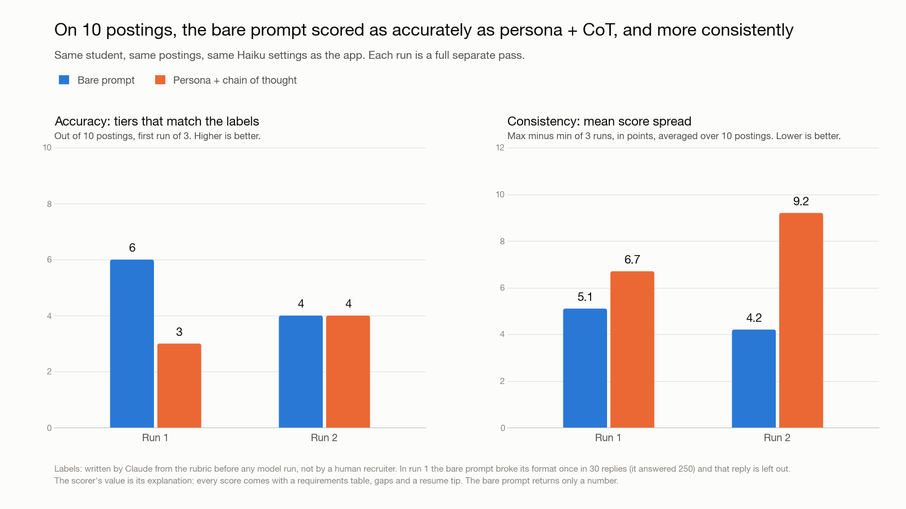

# InternMatch

InternMatch matches STEM students to internships they could actually get. Upload a resume, say what you're looking for, and the app ranks open internships by how competitive you'd be, with a recruiter-style explanation for every score. Refine the results by chatting in plain English.

Built for CS4680 Prompt Engineering.

## How it works

1. **Upload:** a PDF or Word resume, plus an optional "What are you looking for?" box.
2. **Review:** check the parsed profile and search preferences, and fix anything.
3. **Results:** the top 20 matches, each with a fit score, a tier (strong, good, stretch or long shot), a recruiter note and a "Why this score" table. Chat to refine the search, score 10 more, or browse "Also open" postings that have only a title. Results only show roles open to your class standing (undergrad, Master's or PhD).

Plain code does the pulling, filtering and ranking. The language model does only what needs judgment: reading the resume, tagging postings, scoring fit, and turning chat messages into filters. The full design is in [ARCHITECTURE.md](ARCHITECTURE.md).

## Prompt patterns

| Pattern | Prompt | Why |
| --- | --- | --- |
| Few-Shot + structured output | [Resume parser](PROMPTS.md#prompt-1-resume-parser-few-shot--structured-output) | Three worked examples (CS, mechanical, biology) teach the model how to turn any STEM resume into one validated JSON profile. |
| Persona | [Recruiter scorer](PROMPTS.md#prompts-2--3-recruiter-scorer-persona--chain-of-thought) | A senior technical recruiter for the posting's field judges honestly, the way a hiring screen would. |
| Chain-of-thought | Same scorer | The model lists each requirement, finds evidence for it, checks eligibility, then scores. The score is written last, and the reasoning becomes the "Why this score" table. |
| Iterative refinement | [Refinement chat](PROMPTS.md#prompt-4-refinement-iterative-refinement) | Plain-English requests become filter changes that code validates, shows as undoable chips, and searches again. |

Every prompt is stored as a file in `backend/prompts/` and written out in [PROMPTS.md](PROMPTS.md). Every model output is checked with Pydantic and retried once on failure.

## Evaluation

The scorer (persona + chain-of-thought) was compared with a bare prompt, "Rate how well this candidate fits this internship from 0 to 100", on 10 real postings for a made-up mechanical engineering student. Each prompt scored each posting 3 times, and the whole test ran twice.

| Run | Prompt | Tiers matching labels | Mean score spread |
| --- | --- | --- | --- |
| 1 | Bare | 6 / 10 | 5.1 |
| 1 | Persona + CoT | 3 / 10 | 6.7 |
| 2 | Bare | 4 / 10 | 4.2 |
| 2 | Persona + CoT | 4 / 10 | 9.2 |



The scorer did not beat the bare prompt on accuracy or consistency in this small test. It scored more harshly than the labels, counting implied requirements and nice-to-haves as gaps. Its value is that every score comes with checkable evidence, gaps and a resume tip, and its output was valid every time; the bare prompt broke its format once in 30 replies. The labels were written by Claude from a rubric, not by a human recruiter. Details and scripts are in [eval/](eval/).

## Tech stack

- **Backend:** Python, FastAPI, SQLite, APScheduler, scikit-learn (TF-IDF), the Anthropic SDK
- **Frontend:** React, TypeScript, Vite, Tailwind
- **Models:** `claude-sonnet-5-5` for the parser and refinement, `claude-haiku-5-5` for the scorer and ingest taggers

## Setup

You need Python 3.12+, Node 22.22+ and an [Anthropic API key](https://console.anthropic.com/).

1. Copy the environment file and add your key: `cp .env.example .env`, then set `ANTHROPIC_API_KEY` in `.env`.
2. Backend: `cd backend && python3 -m venv .venv && .venv/bin/pip install -r requirements.txt`
3. Frontend: `cd frontend && npm install`
4. Pull postings once (about 10 minutes and 4,000 small Haiku calls the first time): `.venv/bin/python -m app.ingest.pipeline` from `backend/`
5. Run both, then open http://localhost:5173:
   ```sh
   cd backend && .venv/bin/uvicorn app.main:app
   cd frontend && npm run dev
   ```

Tests: `.venv/bin/pytest` and `.venv/bin/ruff check .` in `backend/`; `npm run lint` and `npm run build` in `frontend/`. Run one server process only: the ingest scheduler lives inside it.

## Privacy

- No accounts. Your profile stays in your browser and is sent with each request. "Clear my data" deletes it.
- The resume is read in memory and never stored. The server keeps only scores, keyed by a hash of the profile.
- Resume text and profiles are sent to the Anthropic API for parsing and scoring.

## Data sources and limits

- [SimplifyJobs Summer 2027 internships](https://github.com/SimplifyJobs/Summer2027-Internships), plus the public [Greenhouse](https://developers.greenhouse.io/job-board.html) and [Lever](https://github.com/lever/postings-api) job board APIs for 102 seed companies. No LinkedIn or Indeed.
- City coordinates for the distance filter come from the US Census Gazetteer.
- US postings only. Citizenship and clearance are never filtered or scored, so check those on the posting.
- Scores come from a language model: a guide to where to apply first, not a prediction of an offer.
